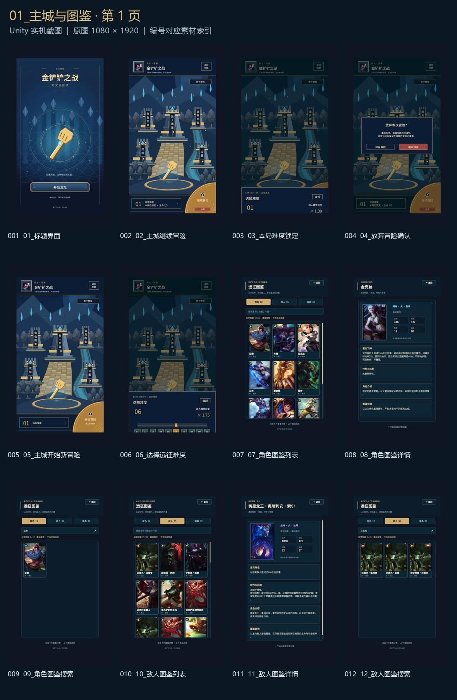
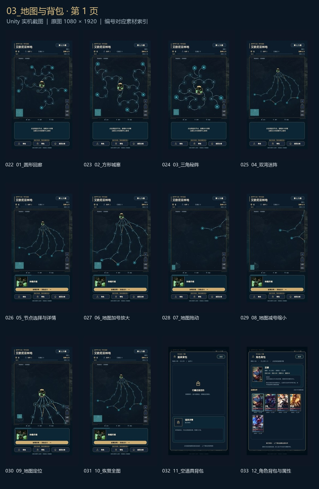
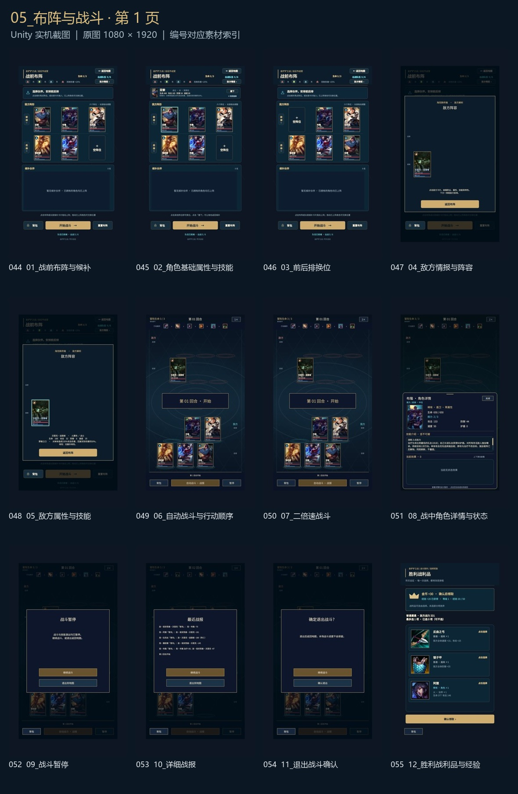
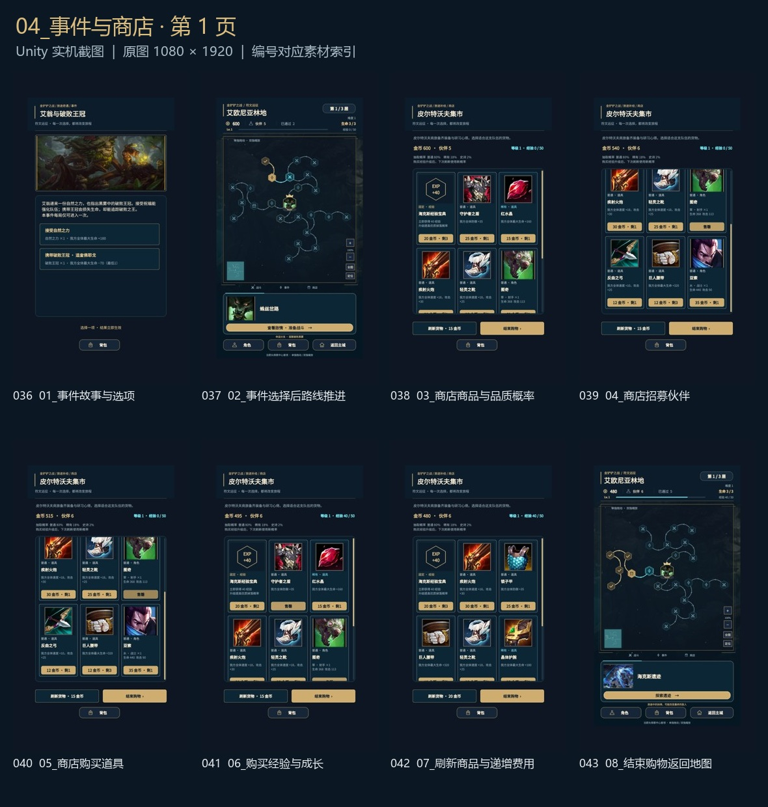
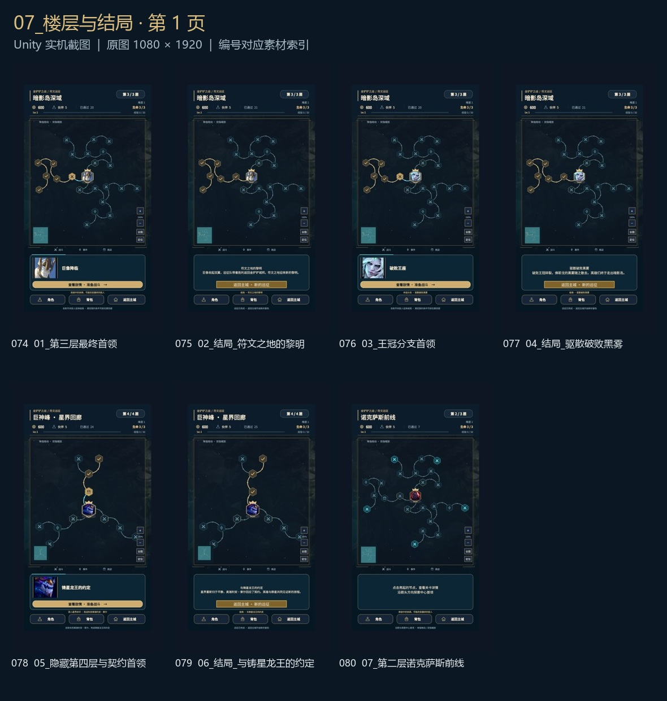
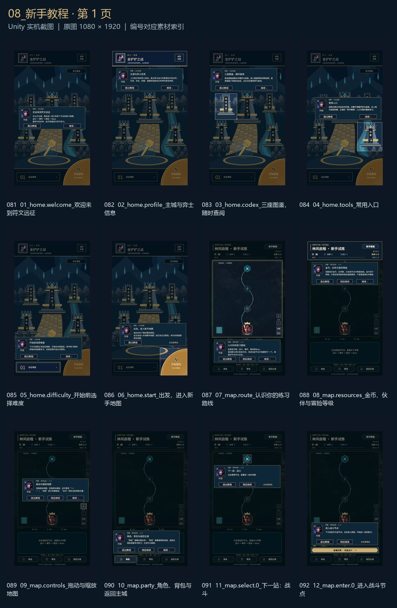
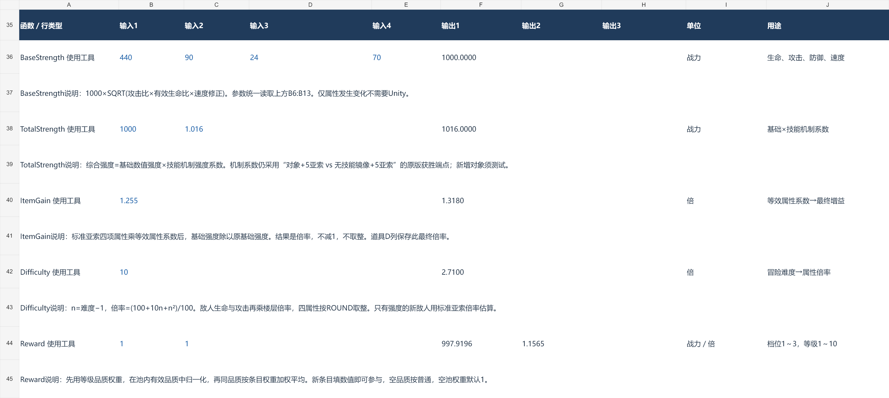
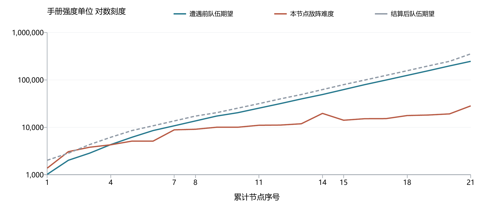

# LOL Tower · 符文远征录

基于 **Unity 2022.3 / C#** 的竖屏单人战术冒险原型。玩家沿分支地图探索，通过招募伙伴、六格布阵、道具叠加与事件选择构筑队伍，在回合制自动战斗中挑战楼层首领。

项目围绕「探索 → 构筑 → 战斗 → 成长」搭建完整冒险流程，同时包含 Excel 配置导入、数值分析手册、存档、图鉴与独立新手试炼。



## 核心玩法

| 系统 | 实现内容 |
| --- | --- |
| 分支地图 | 圆形回廊、方形城塞、三角秘阵、双湾迷阵四种地图；战斗、事件、商店节点与楼层首领；支持地图拖动、缩放和定位 |
| 队伍构筑 | 前后排各三格，支持候补上阵、撤下、拖拽交换、阵容恢复和敌方情报查看 |
| 自动战斗 | 按速度决定行动顺序，包含普攻、技能、属性克制及护盾、治疗等机制；支持二倍速、暂停与战报 |
| 成长与经济 | 冒险等级影响品质概率；角色招募、全队道具叠加、商店刷新与战后多选奖励共同影响构筑 |
| 冒险进度 | 三个基础楼层及满足条件后进入的隐藏第四层；每局初始三点冒险生命，战败扣命，耗尽结束冒险 |
| 主城与引导 | 角色、敌人与道具图鉴，成就、冒险记录、存档继续，以及与正式冒险状态隔离的新手试炼 |

当前内容配置包含 **12 位伙伴、35 种敌人、33 种道具、28 个战斗关卡与 15 个事件**。详细规则见 [游戏说明](Assets/ElementalTactics/README.md)。

## 实机展示

### 地图探索与背包



### 六格布阵与自动战斗



<details>
<summary>展开查看事件商店、结局与新手教程</summary>







</details>

[完整实机截图索引](docx/素材/功能实机演示/实机演示索引.md)收录 **131 张 1080 × 1920 原图**，分为主城图鉴、成就存档、地图背包、事件商店、布阵战斗、失败重试、楼层结局、新手教程八类。下载仓库后，也可用浏览器打开[本地图片画廊](docx/素材/功能实机演示/00_总览与索引/实机演示画廊.html)。

截图拍摄于 2026-11-16，使用独立验证工程和演示存档；部分画面预置资源或进度以展示功能，结局画面为预置通关状态。截图中的设置项代表当时界面状态，当前行为以代码为准。

## 配置与数值设计

运行内容通过 `GameContent.xlsx → 导入校验 → ScriptableObject 数据库` 进入游戏，降低内容配置与运行逻辑之间的耦合。

- **配置校验**：检查工作表、唯一 ID、跨表引用、数值范围、资源路径、奖励池、等级概率与楼层覆盖，更新数据库时保留已有资源 GUID。
- **运行数据**：16 张运行配置表导入为 14 个 SO 数据库；角色、敌人、效果、事件、商店与奖励通过稳定 ID 关联。
- **策划分析**：另设战力规则、单位战力、阵容测算、收益估值、奖励预算、节点估值和关卡难度七张分析表，不直接写入运行数据库。
- **平衡依据**：以队伍有效输出和有效承伤评估战力，分析角色替换、道具叠加、品质概率、成长递推及敌阵难度。分析模型用于平衡参考，需结合实战校准。





曲线为手册中的概率近似模型，不代表实际通关结果。完整说明见 [配置管理](Assets/ElementalTactics/Data/配置管理说明.md)及[手册截图索引](docx/素材/手册截图/手册截图索引.md)。

## 打开与运行

1. 使用 Unity Hub 添加仓库根目录，安装并选择 **Unity 2022.3.62f3c1**。若需导出安卓安装包，安装对应 Android Build Support、SDK、NDK 与 OpenJDK。
2. 等待 Package Manager 还原依赖与资源导入。`Packages/manifest.json` 包含 Unity MCP 的 Git 依赖，首次还原需要网络和 Git。
3. 打开 `Assets/ElementalTactics/Scenes/StartScene.unity`，进入 Play Mode，从开始界面进入冒险。
4. 构建场景列表见 `ProjectSettings/EditorBuildSettings.asset`；通过 Unity 的 Build Settings 选择目标平台并构建。默认、桌面端及安卓普通、圆形、自适应图标已配置。

修改运行配置时，保存 `Assets/ElementalTactics/Data/GameContent.xlsx`，退出 Play Mode 后执行 **Tools → Elemental Tactics → Import Game Workbook**。数值手册与运行配置不自动双向同步，涉及手册同步的修改应遵循配置管理文档，再开始新冒险验证。

## 工程结构

```text
Assets/ElementalTactics/
├── Runtime/           # 战斗、布阵、地图、背包、成长及 UI
├── Editor/            # 配置导入、场景生成与规则验证工具
├── Data/              # 配置工作簿与说明
├── Resources/         # 数据库、图像、音频等运行资源
├── Scenes/            # 开始、主城、地图与关卡场景
├── Branding/          # 应用图标及安卓自适应图层
└── Fonts/             # 字体资源
docx/                  # 策划案、数值手册与展示素材
Packages/              # 依赖清单与锁定版本
ProjectSettings/       # Unity 工程及构建设置
Tools/                 # 图标生成等辅助工具
```

代码目录说明见 [FILE_STRUCTURE](Assets/ElementalTactics/FILE_STRUCTURE.md)。策划案位于 `docx/策划案_v1_前六章完整版.docx`，数值手册位于 `docx/英雄敌人与道具数值机制手册_v3_纯公式版_2026-11-03.xlsx`。

`Library`、`Temp`、`Logs`、`UserSettings`、IDE 自动生成文件及 `GAME` 构建导出目录由忽略规则排除，打开工程时由 Unity 按需生成。

## 项目定位

本项目为采用《金铲铲之战》角色与世界观设定的同人战术原型，展示玩法设计、Unity 功能实现、配置工具和数值分析流程。角色及世界观相关权利归原权利方所有；项目中使用的第三方素材按各自授权说明管理。
